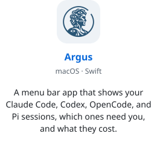
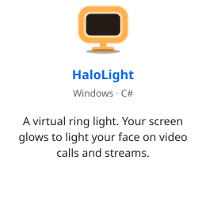
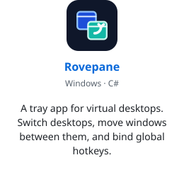

<h1 align="center">Hi, I'm Bashar</h1>

Senior software engineer  
I build the tools I wish someone else had made.

 

<a href="https://github.com/BasharIQ/argus"><picture><source media="(prefers-color-scheme: dark)" srcset="assets/cards/argus-dark.svg"></picture></a>
<a href="https://github.com/BasharIQ/HaloLight"><picture><source media="(prefers-color-scheme: dark)" srcset="assets/cards/halolight-dark.svg"></picture></a>
<a href="https://github.com/BasharIQ/Rovepane"><picture><source media="(prefers-color-scheme: dark)" srcset="assets/cards/rovepane-dark.svg"></picture></a>

 

<a href="https://bash.ar">bash.ar</a> · <a href="mailto:hi@bash.ar">hi@bash.ar</a>

