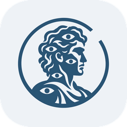
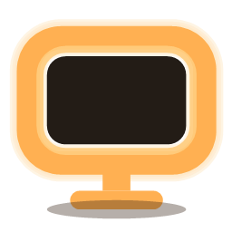
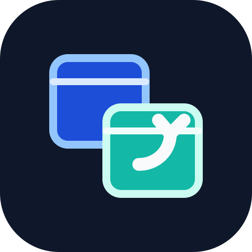

<h1 align="center">Hi, I'm Bashar</h1>

Senior software engineer  
I build the tools I wish someone else had made.

 

<table align="center">
<tr>
<td align="center" valign="top" width="260">
<a href="https://github.com/BasharIQ/argus"> <b>Argus</b></a> 
macOS · Swift  
A menu bar app that shows your Claude Code, Codex, OpenCode, and Pi sessions, which ones need you, and what they cost.
</td>
<td align="center" valign="top" width="260">
<a href="https://github.com/BasharIQ/HaloLight"> <b>HaloLight</b></a> 
Windows · C#  
A virtual ring light. Your screen glows to light your face on video calls and streams.
</td>
<td align="center" valign="top" width="260">
<a href="https://github.com/BasharIQ/Rovepane"> <b>Rovepane</b></a> 
Windows · C#  
A tray app for virtual desktops. Switch desktops, move windows between them, and bind global hotkeys.
</td>
</tr>
</table>

 

<a href="https://bash.ar">bash.ar</a> · <a href="mailto:hi@bash.ar">hi@bash.ar</a>

